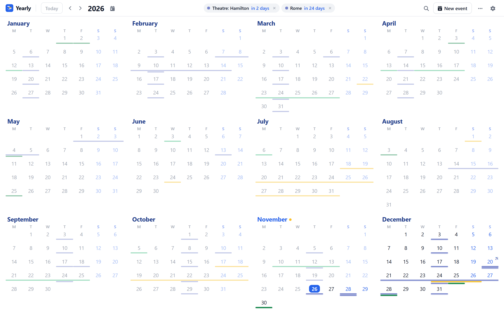
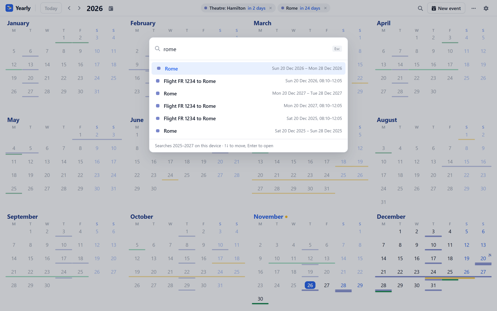
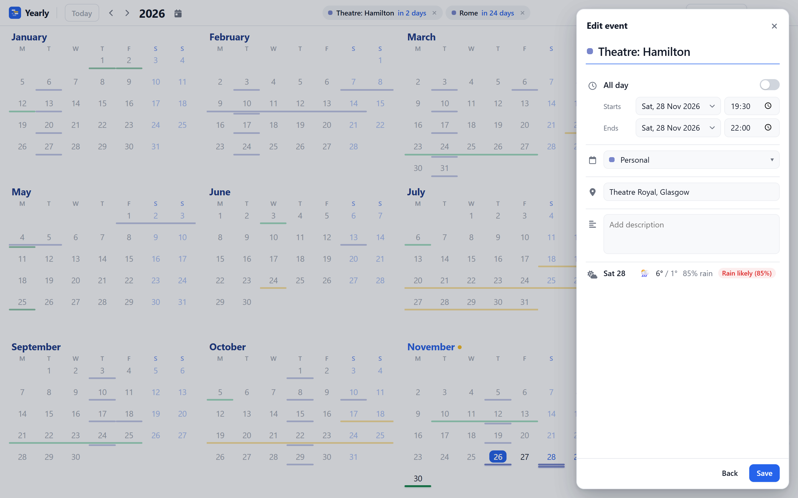
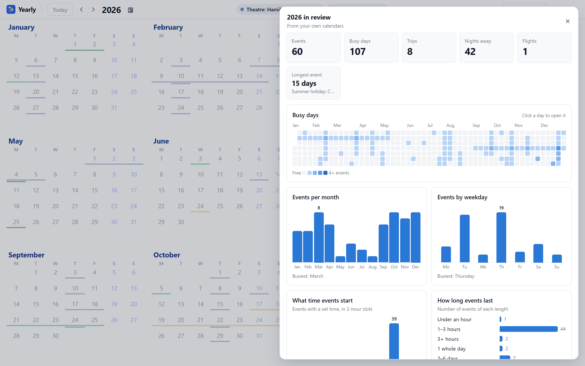
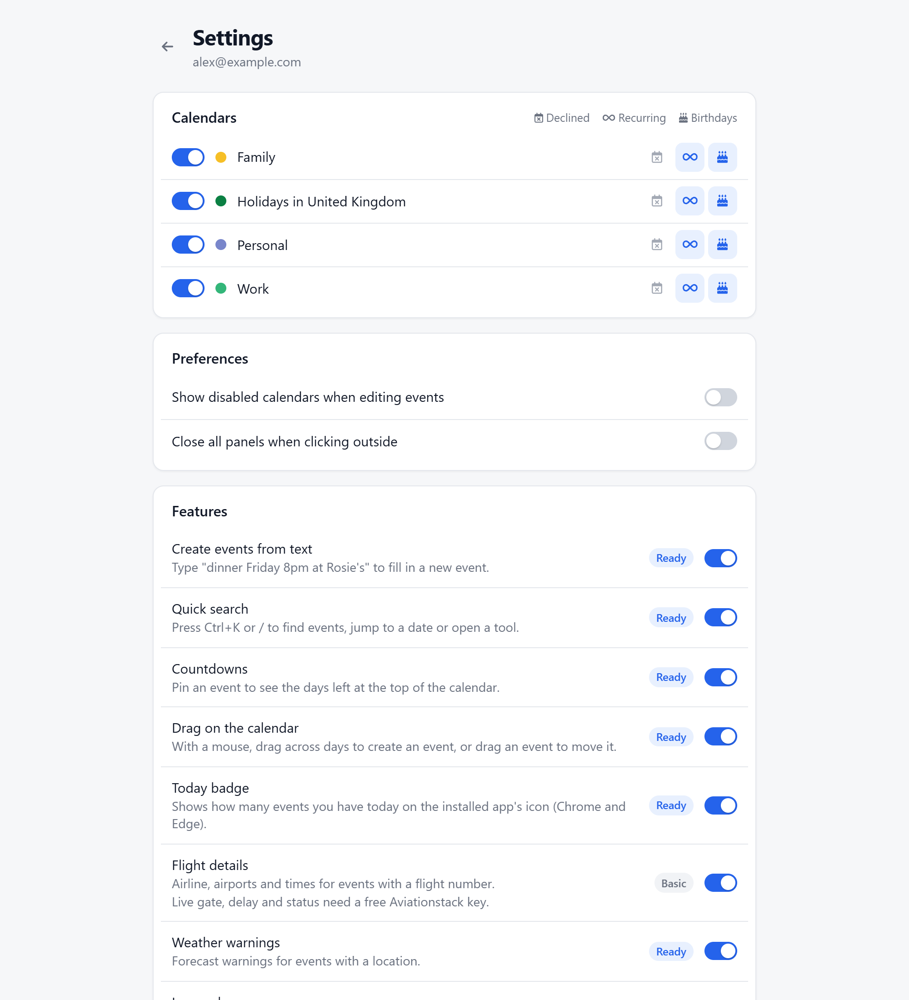

# Yearly

Your whole year from Google Calendar on one screen. Yearly shows every day of the year at a glance, with a line for
each event, and adds a few helpers on top: quick search, countdowns, travel and crowd warnings, weather, a leave
planner, a year in review, questions about your calendar, and notifications.

It's an Angular app hosted on Firebase. It talks to Google Calendar straight from the browser, and a small optional
server on your own VPS adds notifications and a few APIs that browsers can't call.



- [Features](#features)
- [Settings and API keys](#settings-and-api-keys)
- [Privacy](#privacy)
- [Set up your own copy](#set-up-your-own-copy)
- [The Yearly server (optional)](#the-yearly-server-optional)
- [Development](#development)

## Features

Every feature can be switched off in **Settings → Features**. A feature that needs an API key stays off until you add
one, and a missing key only turns off the features that need it.

### The year at a glance

- All 12 months on one screen on a computer. On a phone the months scroll, and the app opens on today.
- Each event is a coloured line under its days, in the calendar's colour. Multi-day events run across their days
  without a break. Hover over a day (with a mouse) to preview its events, click it to see them all.
- **Today** jumps back to today, and lights up when today isn't on screen. ‹ › change the year, and 📅 goes to any date.
- **New event:** pick the first and last day, or with a mouse **drag across days**.
  **Drag an event** to move it to other days; a notice offers **Undo**.
- **Type it:** describe an event in words, such as "dinner Friday 8pm at Rosie's", and the form fills itself in.
  This runs on your device, without AI.

### Quick search

Press **Ctrl+K** (or **/**), or the 🔍 button. Search finds events by title or place in the years loaded so far,
upcoming ones first. Type a date such as "5 march" or "next friday" to jump to it, or the name of a tool to open it.
Everything runs on your device.



### Countdowns

Open a day, pin an event with 📌, and a chip at the top shows the days left, for example "Ski trip · in 12 days".
Click it to jump to the event. Pins stay on this device and go once the event ends.

### Today badge

When Yearly is installed as an app (Chrome or Edge), its icon shows how many events you have today. It updates while
the app is open.

### Event details

Opening an event shows extra details underneath when they apply:

- **Flight details:** a flight number in the title (such as "FR 1234") shows the airline, airports and times. Live
  gate, delay and status need a free Aviationstack key and show only around the day of the flight.
- **Weather warnings:** for events with a place, up to 16 days ahead (Open-Meteo, no key).
- **Travel buffers:** the driving time from the previous event and to the next, with a warning when it's tight or
  late (free TomTom key).
- **Crowd and traffic alerts:** concerts, shows and matches near the venue around the same time (free Ticketmaster
  or football-data.org key), and with your home address and a TomTom key, when to leave.



### Tools in the ••• More menu

- **Ask your calendar:** questions like "when is my next free weekend?". Simple questions are answered on the device;
  the rest go to Google Gemini with only the events the question is about. Needs a free Gemini key. The chat is kept
  on this device until you clear it or log out.
- **Leave planner:** bank holidays for your country and region, and the best days to take off around them.
- **Year in review:** charts of your year: busiest days and months, calendars, places, trips and more.



### Notifications

With the [Yearly server](#the-yearly-server-optional) set up, turn on **Settings → Notifications on this device**.
Each time Yearly opens on that device, it looks at your next 3 days and sends the server any warnings:

| Alert | Sent | Needs |
|---|---|---|
| Leave by 18:35 for Theatre (match nearby or heavy traffic) | 15 minutes before the leave-by time | Crowd alerts, home address, TomTom key |
| Busy near Theatre (match or concert nearby) | 2 hours before the event | Crowd alerts (without a home address) |
| Weather for BBQ tomorrow | 19:00 the evening before | Weather warnings |
| Not enough time to get to Drinks | 08:00 that day | Travel buffers |

A normal day sends nothing. **Send a test** checks that notifications arrive. On iPhone and iPad, Yearly must first
be added to the Home Screen (iOS 16.4 or newer).

If the test doesn't appear, the device is usually hiding it: on Windows, check **Settings → System →
Notifications** for Do not disturb and that your browser's notifications have **banners** turned on (otherwise they
only go to the notification centre, Win+N). In Chrome, `chrome://gcm-internals` shows whether the notification
reached the browser.

Alerts are as fresh as the last time Yearly opened on that device: a change made only in Google Calendar reaches the
alerts the next time Yearly opens.

## Settings and API keys



**Settings** has:

- **Calendars:** which calendars to show, and per calendar whether to include repeating events, birthdays and
  declined events.
- **Features:** a switch and a status for each feature, your home address (for travel times), and notifications for
  this device.
- **API keys:** for each service, where to get a free key and how, a Test button, and how much of the free allowance
  is used. Keys and counts sync between your devices through a hidden app folder in your own Google Drive.

All the services have free plans that need no card:

| Service | Used for | Get a key |
|---|---|---|
| Gemini | Ask your calendar | [aistudio.google.com/apikey](https://aistudio.google.com/apikey) |
| TomTom | Travel buffers, leave-by times | [developer.tomtom.com](https://developer.tomtom.com) |
| Ticketmaster | Crowd alerts (concerts, shows) | [developer.ticketmaster.com](https://developer.ticketmaster.com) |
| football-data.org | Crowd alerts (matches); needs the Yearly server | [football-data.org](https://www.football-data.org/client/register) |
| Aviationstack | Live flight status | [aviationstack.com](https://aviationstack.com) |

Weather (Open-Meteo), places (OpenStreetMap) and bank holidays (Nager.Date) need no key.

## Privacy

- Google Calendar is read and changed straight from your browser with your own Google sign-in.
- API keys stay in your browser and your own Google Drive. Requests go from your device to each service, except
  football-data.org (and Ticketmaster when the browser can't reach it), which pass through the Yearly server without
  being stored or logged.
- With notifications on, the Yearly server keeps each upcoming alert (event title, time, short message) until it's
  sent, then deletes it. Logging out or turning notifications off deletes the device.
- Ask your calendar sends your question and the matching events to Google Gemini.

The full privacy policy is in the app at `/privacy-policy`.

## Set up your own copy

You need a Google account, a Firebase project and Node.js 18 or newer.

1. **Google Cloud project** (the one Firebase creates is fine):
   1. Enable the **Google Calendar API** and the **Google Drive API**.
   2. In **Google Auth Platform**, set up the consent screen and add these scopes under **Data Access**:
      `calendar.readonly`, `calendar.events` and `drive.appdata`.
   3. Create an **OAuth client ID** of type **Web application**, and add your site's address (and
      `http://localhost:4200` for development) to **Authorised JavaScript origins**.
2. In `src/app/app.config.ts`, set `googleClientId` to your client ID.
3. Set up [deploying from GitHub](#deploying).

## Deploying

Every push to `main` deploys by itself, through GitHub Actions ([.github/workflows/deploy.yml](.github/workflows/deploy.yml)).
Two jobs run side by side:

- **App:** runs the tests, works out the new version, builds the app, deploys it to Firebase Hosting, and tags the
  commit with the version.
- **Server:** copies the [Yearly server](#the-yearly-server-optional) to your VPS over SSH and installs or updates it.
  It's skipped while the `VPS_HOST` secret isn't set.

Pushes that only change documentation (`*.md`, `docs/`) don't deploy. To deploy by hand, open
**Actions → Deploy → Run workflow** on GitHub.

### Secrets

Set them on GitHub in the repository's **Settings → Secrets and variables → Actions → New repository secret**. Secrets
stay out of the repository and are hidden in the public logs.

| Secret | Needed for | Value |
|---|---|---|
| `FIREBASE_SERVICE_ACCOUNT_YEARLY_2024` | The app | Made for you by `npx firebase-tools init hosting:github` (see below) |
| `SERVER_URL` | The server's features in the app, and the server | `https://api.` + your app's domain, such as `https://api.yearly.your-domain.com` with your real domain |
| `VPS_HOST` | The server | The VPS's IP address, such as `203.0.113.10` |
| `VPS_USER` | The server | The user GitHub logs in as: `root`, or a user allowed to run `sudo` without a password. Defaults to `root` |
| `VPS_SSH_KEY` | The server | The private SSH key GitHub logs in with (see below) |
| `LETSENCRYPT_EMAIL` | The server's first deploy | Your email address, for the free HTTPS certificate. Setting it means you accept the [Let's Encrypt terms](https://letsencrypt.org/repository/) |

Without the server secrets, the app still deploys, with the features that need the server switched off.

### One-time setup

1. **Let GitHub deploy to Firebase:** run `npx firebase-tools init hosting:github` and pick this repository. It creates
   a service account and saves its key as `FIREBASE_SERVICE_ACCOUNT_YEARLY_2024`. Answer **No** to both questions
   about setting up workflows: the repository already has its own. (For your own Firebase project, change `projectId`
   and the secret's name in `deploy.yml`, the Firebase addresses in its server job, and the project in `.firebaserc`.)
2. **DNS for the server:** next to your Firebase records, add an `A` record named `api.yearly` (that is, `api.` + your
   app's domain) with the VPS's IP address, and an `AAAA` record if it has IPv6. On Cloudflare, make it DNS only.
3. **Let GitHub log in to the VPS** with a user and key just for deploying. Below, `203.0.113.10` stands for your
   VPS's IP address, and you log in to the VPS as you normally do (here `root`).
   1. **Make the key** on your computer (PowerShell or a terminal). When it asks for a passphrase, press Enter twice:
      GitHub has to use the key without one.

      ```sh
      ssh-keygen -t ed25519 -C "yearly deploy" -f yearly-deploy
      ```

      This makes `yearly-deploy` (the private half) and `yearly-deploy.pub` (the public half).
   2. **Make the user** on the VPS. It has no password, so it can only log in with the key, and may use `sudo`
      without one, which the install needs:

      ```sh
      adduser --disabled-password --gecos "" yearly-deploy
      echo 'yearly-deploy ALL=(ALL) NOPASSWD:ALL' > /etc/sudoers.d/yearly-deploy
      chmod 440 /etc/sudoers.d/yearly-deploy && visudo -c
      ```

   3. **Give the user the public half**, from your computer:

      ```sh
      cat yearly-deploy.pub | ssh root@203.0.113.10 "install -d -m 700 -o yearly-deploy -g yearly-deploy /home/yearly-deploy/.ssh && cat >> /home/yearly-deploy/.ssh/authorized_keys && chown yearly-deploy: /home/yearly-deploy/.ssh/authorized_keys && chmod 600 /home/yearly-deploy/.ssh/authorized_keys"
      ```

   4. **Check it:** `ssh -i yearly-deploy yearly-deploy@203.0.113.10 "sudo -n true && echo ready"` prints `ready`.
   5. **Secrets:** set `VPS_USER` to `yearly-deploy`, and paste the whole of `yearly-deploy` (the private half,
      including its `BEGIN` and `END` lines) into `VPS_SSH_KEY`. Then delete both key files from your computer.

   Since the install needs root, this user can do anything root can. Its advantage over logging in as `root` is that
   you can remove it, or its key, without touching your own login. To use `root` instead, skip step 2, give the key
   to `root` in step 3 (`ssh-copy-id -i yearly-deploy.pub root@203.0.113.10` on Mac or Linux), and leave `VPS_USER` empty.
4. **The other secrets** from the table, then run **Actions → Deploy → Run workflow**.

### What the first deploy does

The app job deploys the app as usual. The server job, once `dig +short api.yearly.your-domain.com` shows the VPS:

1. logs in to the VPS and copies the server there;
2. installs what's missing: Apache, Node.js and certbot (on Debian 12 or Ubuntu 24.04, whose Node.js is new enough);
3. runs the server as the `yearly` service, and adds the Apache site `api.yearly.your-domain.com` that passes requests to it;
4. gets the free HTTPS certificate, which certbot then renews by itself, and makes plain HTTP redirect to HTTPS;
5. checks that `https://api.yearly.your-domain.com` answers.

So there's nothing to set up in Apache by hand. Port 80 must be reachable for the certificate (and 443 for HTTPS). If
DNS isn't ready yet, the job fails with a message saying so; the next deploy tries again. Later deploys only update the
server.

### Versions

Each deploy gets the next version from the commits since the last release tag, read from their gitmoji: 💥 (or
`BREAKING`) is a major change, ✨ or 🎉 a new feature (minor), anything else a fix (patch). For example, after `1.4.0`,
a push with a ✨ commit is released as `1.5.0`. The tag is pushed to GitHub, and Settings shows the version. A copy
built on your computer shows `0.0.0-dev`. The `version` in `package.json` is only the starting point before the first
tag.

### Deploying from your computer

Only if GitHub can't, since the build needs the version and server address:

```sh
npx ng build --define "YEARLY_VERSION='1.4.0'" --define "YEARLY_SERVER_URL='https://api.yearly.your-domain.com'"
npx firebase-tools deploy --only hosting
```

For the server, see [server/README.md](server/README.md).

## The Yearly server (optional)

Notifications and football-data.org need a small server: one Node file with no dependencies, which runs on your own
VPS behind Apache. It keeps nothing but upcoming alerts and its own notification keys.

The server always lives at `api.` followed by the app's own domain: for an app at `https://yearly.your-domain.com`,
it's `https://api.yearly.your-domain.com`. The app stays on Firebase, and only the new name points at the VPS (Firebase
Hosting can't forward requests to another server).

> **`yearly.your-domain.com` stands for your app's real domain.** Replace it everywhere. The install script refuses
> the example address, and the app ignores a server address that still contains it.

GitHub installs and updates it with every deploy once its [secrets](#secrets) are set. To install it by hand instead,
and for checking, uninstalling and what it stores, see [server/README.md](server/README.md).

## Development

```sh
npm start                                         # http://localhost:4200
npx ng test --watch=false --browsers=ChromeHeadless
node --test server/yearly-server.test.mjs
npx ng build
```

- Set `mockData` to `true` in `src/app/app.config.ts` to try the app with sample events and no Google sign-in.
  Remember to set it back.
- On `localhost`, the app looks for the Yearly server at `http://localhost:8787`. Start it with
  `$env:ALLOWED_ORIGINS = 'http://localhost:4200'; node server/yearly-server.mjs` (PowerShell).
- The service worker, and so notifications, only runs in the production configuration. To try notifications locally,
  run the app with `npx ng serve --configuration production` (still on port 4200). Reload the page twice after a
  change: the service worker serves the previous version first.
- Versions and deploys are automatic: see [Deploying](#deploying).
